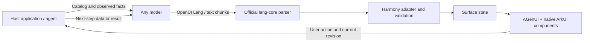

# Harmony OpenUI


[简体中文](README.md) | English

**OpenUI Lang → native HarmonyOS ArkUI interfaces.**

An independent community adapter that reuses the official OpenUI parser, renders model-generated component declarations with precompiled ArkUI components, and returns user actions to the host application. Built for choices, data entry, multistep forms, and result panels in chat. No WebView or on-device compilation of generated ArkTS is required.

This is not an official OpenUI or Huawei SDK. v0.2 adds forms, images, lists, and confirmation dialogs to a bounded catalog; it is not a complete port of OpenUI Lang 1.0 or the entire ArkUI component system.

v0.2 completed **model-generated form → native editing and validation → confirmation sheet → model-generated result** on a physical Nova phone. Reopening chosen dates, repeated time changes, cancel-without-submit, and native image loading were checked. Travel is an acceptance fixture; the SDK contains no ticket-booking business logic. [v0.2 verification](docs/verification-v02.md) · [Actual model output and build receipt](docs/evidence/2026-10-20-v02/acceptance.json)

| Model form | Native controls | User confirmation | Model result and image |
| --- | --- | --- | --- |
|  |  |  |  |

<details>
<summary>Historical v0.1 device evidence: choices, themes and card isolation</summary>

The v0.1 standalone demo completed **real MiniMax generation → native option tap → model-generated result on the same surface** on a physical Nova phone. Light/dark themes, expandable details, equal-ID card isolation, and resizing were also exercised. These historical screenshots use fictional data; Sofia integration is not included.

| Model-generated choices | Result after selection | Dark result | Narrow card and independent theme |
| --- | --- | --- | --- |
|  |  |  |  |

[Device verification and artifact hashes](docs/verification.md) · [Actual model output and acceptance receipt](docs/evidence/2026-10-20/acceptance.json)

</details>

## How it fits together



Harmony OpenUI adds a native adaptation layer around the official parser. It does not embed the upstream web renderer or reproduce its full component catalog.

| Layer | Implementation |
| --- | --- |
| Language parsing | The actual `@openuidev/lang-core@1.0.1` parser, bundled from the pinned dependency. |
| Component contract | A bounded catalog, with schema and model prompt generated from the same definitions. |
| State and actions | A platform-neutral component representation, surface controller, revisions, live form values and validation, selection, read-only state, snapshots, and validated action receipts. |
| HarmonyOS rendering | The public `@agenui/agenui@1.6.0` native backend and precompiled ArkUI builders for composite components. The adapter handles native sizing, themes, mount isolation, and action routing. |
| Application behavior | Model transport, data retrieval, tools, permissions, history, persistence, and business effects belong to the host. |

The model supplies declarations and content, rather than executable ArkTS. An action such as choosing an option returns data to the host; the host decides what happens next.

## What v0.2 includes

- The official parser, generated component schema, and model system prompt.
- Incremental parsing, retention of the last valid interface, and complete-program replacement. Incomplete native properties do not interrupt incoming text chunks.
- `Stack`, `Row`, `Card`, `Text`, `Button`, `Option`, `Facts`, `Status`, and `Details`.
- New `Form`, `TextInput`, `TextArea`, `Search`, `Checkbox`, `Toggle`, `Select`, `RadioGroup`, `Slider`, `DatePicker`, `TimePicker`, `Image`, `List`, and `Dialog`: 23 model-facing components in total, not a complete ArkUI mapping.
- Live field values stored separately from model-authored declarations. Editing does not increment the document revision or remount the whole card. The controller validates `@Submit` and attaches the current user values.
- Independent surfaces and themes, selected/read-only state, snapshots, layout-status receipts, stale-callback rejection, and event deduplication.
- A standalone demo for choices followed by results, and for trip details → preferences → results. A real model can generate the first form and final result; the middle preferences page is a host-supplied example.
- An optional A2UI v0.9 / v0.9.1 NDJSON subset adapter sharing the same state and rendering layers.

The SDK contains no model network client. Selecting a component does not automatically place an order, make a payment, or operate another app.

## Quick start

Build the HAR and add it as a local dependency to your HarmonyOS project, retaining its public OHPM dependencies. This repository does not currently document an npm or OHPM registry release of Harmony OpenUI. The compile target is HarmonyOS API 24, with a minimum compatible API of 20. Public exports are in [`openui/Index.ets`](openui/Index.ets).

After building, run this in the host module directory:

```powershell
ohpm install D:/openui-build/har-01/artifacts/harmony-openui-0.2.0.har
```

Import the local package as `@hreyulog/harmony-openui`. The parser is bundled in the HAR; the host does not need a separate npm parser or model SDK.

```ts
import { OpenUiController, OpenUiActionReceipt, OpenUiLanguageStream,
  OpenUiView } from '@hreyulog/harmony-openui';

@Component
struct GeneratedPanel {
  private controller: OpenUiController = new OpenUiController({
    onAction: (event: OpenUiActionReceipt): void => {
      // The host decides whether to select, disable, run a tool,
      // or request another model-generated interface.
      console.info(event.name + ': ' + JSON.stringify(event.context));
    }
  });
  private stream: OpenUiLanguageStream =
    new OpenUiLanguageStream(this.controller, 'answer');

  aboutToAppear(): void {
    this.stream.replace('root = Stack([Text("Choose the next step", "heading"), ' +
      'Option("Option A", "Example description", "Available", @Choose("a"))])');
  }

  build() {
    OpenUiView({ controller: this.controller, surfaceId: 'answer' })
  }
}
```

Provide `OpenUiLanguageStream.systemPrompt()` as the model's system instruction, together with facts obtained by the host. For streaming content, call `append(chunk)` on the same stream in order, then `append('', true)` when the response ends. Use a new stream or `replace(source)` for a new complete response.

`@Choose("a")` produces `name: 'choose', context: { value: 'a' }`. `@ToAssistant` and `@OpenUrl` also return action data only; the host implements their effects. See the [schema](schemas/openui-lang-v0.1.json) and [catalog definitions](tools/lang/library.mjs) for the supported syntax.

The host explicitly calls `controller.setSelected(surfaceId, componentId)` and `controller.setReadOnly(surfaceId, true)` when appropriate. To continue, it runs a tool or requests another model response, then supplies the new interface to the stream. `onAction` itself only returns an event.

## Forms and continuation

The same catalog lets a model declare inputs without generating executable ArkTS or assembling the user's answers inside an action:

```text
root = Stack([trip])
trip = Form("trip", [name, seat, date, send])
name = TextInput("traveler", "Traveler", "", "Enter a name", true)
seat = Select("seat", "Seat class", [{label:"Second class",value:"second"},{label:"First class",value:"first"}], "second", true)
date = DatePicker("date", "Departure date", "2026-10-23", "2026-10-20", "2026-12-31", true)
send = Button("Continue", @Submit("trip"))
```

The declaration for `@Submit("trip")` contains only `{ form: 'trip' }`. After the user enters valid data, the host receives `name: 'submit', context: { form: 'trip', fields: { traveler: '…', seat: 'second', date: '…' } }`. These values come from current controller state. Model-authored or native-callback field payloads are rejected; read-only, disabled, revision, and deduplication checks remain in effect. The host is responsible for trustworthy defaults; format validation does not establish factual accuracy. The host decides whether to render the next form, call a business tool, or request a result.

Use `onFieldChange` for edit notifications, `getFormValues(surfaceId, formName)` to read values, `validateForm` to show validation errors, and `setFieldValue` for host-driven edits. Supply `validationMessage(code, component)` for localized errors. Forms cannot nest, field keys are unique within each form, and disabled controls are omitted from submission. Dates use `YYYY-MM-DD` within `0001-01-01`–`5000-12-31`; times use 24-hour `HH:mm`.

`Image` accepts a host-supplied HTTPS URL and alternative text, loaded by a native image component. `List` has a bounded 120–480 vp scroll viewport. `Dialog` opens a native confirmation sheet after a user tap; cancellation returns no action. See the [state contract](docs/protocol.md) and [architecture](docs/architecture.md).

## Build and test

Requirements: Python 3.10+, Node.js 22.18+ or 24, pnpm 11.25.0, Git, and Huawei's official HarmonyOS Command Line Tools 6.1.1 / API 24 SDK with DevEco JBR (Java 17). Windows PowerShell example:

```powershell
pnpm install --frozen-lockfile --ignore-scripts
pnpm run build:lang
pnpm test
python -m unittest discover -s tests -p 'test_*.py'

# Use a fresh output directory outside the source checkout.
python tools/build.py --target har --work-dir D:/openui-build/har-01 `
  --cli-home <HarmonyOS-command-line-tools> --java-home <JBR>

# Compile the standalone demo; an unsigned HAP cannot be installed.
python tools/build.py --target all --unsigned --work-dir D:/openui-build/demo-01 `
  --cli-home <HarmonyOS-command-line-tools> --java-home <JBR>
```

The build script freezes sources into the external directory, installs locked dependencies, generates the parser, and compiles the selected targets. It records logs, dependency checks, and artifact hashes. The public AGenUI 1.6.0 archive and its installed files are checked for integrity. Use a new `--work-dir` for each build; `--node` and `--pnpm` can specify executable paths.

To install the demo on a retail device, register its exact bundle, `com.hreyulog.harmonyopenui.demo`, and create a legitimate device debug Profile in AGC. Build with `--signing-config <private-JSON-outside-the-checkout>`. Signing materials must stay private; the script rejects a Profile with the wrong bundle. See [building.md](docs/building.md) for signing and model configuration.

## Demo and verification

The demo uses explicitly fictional itinerary data to test interaction; it is not a live ticket search. It supports OpenAI-compatible and Anthropic-compatible HTTPS model requests. Keys entered through its configuration screen remain in memory. An optional developer configuration file must remain in the app-private directory, outside the package and repository.

The current demo receives complete model HTTP responses and then feeds them to the parser in chunks. It does not implement provider SSE framing. The SDK can accept text chunks from a real network stream. After a choice, the host requests the result and updates the same surface.

The new native forms example has three stages: `trip → preferences → result`. With “Model form”, a real model generates the initial trip form. After submission, the host supplies a fixed preferences form; confirming its native sheet sends both sets of submitted values to the model for a read-only result, list, and project banner. “Reset example” uses local demonstration data throughout. Model output, submitted values, and actual image loading need separate checks. This flow does not search, reserve, or purchase tickets.

The v0.2 candidate accepted on 2026-10-20 passed **91 Node tests and 2 Python tests**, HAR/signed-HAP compilation, and the documented native flow on a **HUAWEI nova 15 Pro, API 26**. Host tests do not replace native visual and interaction checks. API 20 is the declared compatible minimum, including `LayoutPolicy.fixAtIdealSize`; physical acceptance covers API 26, not every supported OS version.

See the [v0.2 verification record](docs/verification-v02.md) for exact scope, submitted values, screenshots, and artifact hashes.

## Current limitations

- `$state`, Query / Mutation, multi-step actions, charts, video, navigation, arbitrary drawing, and the complete upstream / ArkUI catalogs are not supported. A multistep form is a host-orchestrated sequence of single-step submissions, not an executable model-defined workflow.
- The native backend uses AGenUI's public extension API and ArkUI builders. Structural updates still remount a surface; field edits synchronize values and errors without remounting. Complete fine-grained structural diffing is not implemented. Hosts can coalesce frequent model updates.
- Images need host-supplied HTTPS URLs and a working network/permission environment. The library does not search for images or guarantee remote availability. Lists have bounded data and viewports, without remote pagination or infinite loading.
- The A2UI adapter implements a limited subset, not full protocol conformance.
- The SDK and demo are independent of Sofia; integration has not been implemented.

Documentation: [Architecture](docs/architecture.md) · [Protocol and state](docs/protocol.md) · [Rendering and themes](docs/rendering.md) · [Build](docs/building.md) · [Verification](docs/verification.md)

Upstream references: [OpenUI architecture](https://www.openui.com/docs/openui-lang/architecture) · [Defining components](https://www.openui.com/docs/openui-lang/defining-components) · [ArkUI](https://developer.huawei.com/consumer/cn/arkui/) · [AGenUI](https://github.com/AGenUI/AGenUI)

## License

The adapter, state layer, rendering integration, demo, and tools are Apache-2.0. The official OpenUI parser and Zod retain MIT licensing. AGenUI's main library is Apache-2.0; its native dependencies retain LGPL-2.1, MIT, and other applicable licenses. See [LICENSE](LICENSE), [NOTICE](NOTICE), [THIRD_PARTY_NOTICES](THIRD_PARTY_NOTICES), and [native dependency notes](docs/third-party-native.md).
