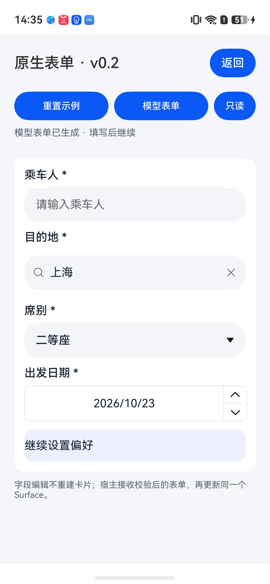
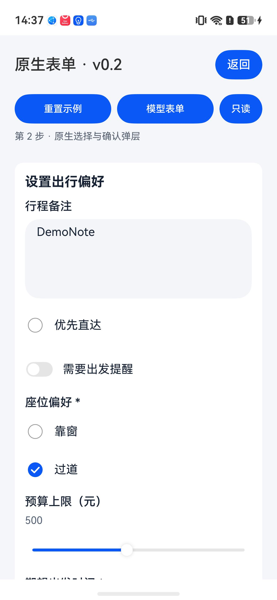
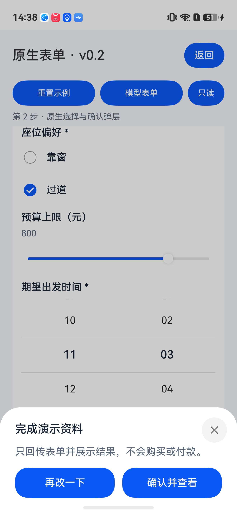
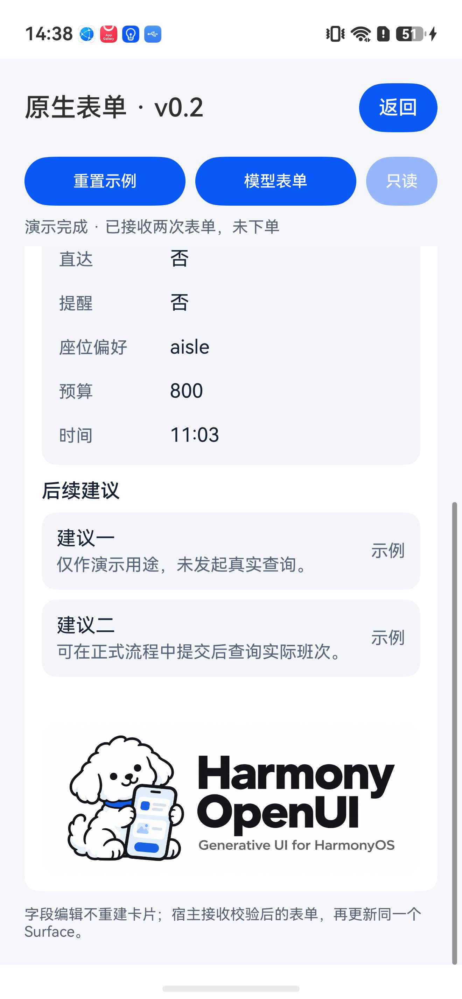
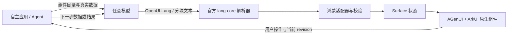

# Harmony OpenUI


简体中文 | [English](README.en.md)

**OpenUI Lang → HarmonyOS ArkUI 原生界面。**

一个独立的社区适配库：复用 OpenUI 官方解析器，以 AGenUI 为原生渲染后端，让模型输出的组件声明显示为鸿蒙界面，再把用户操作交回宿主应用。适合聊天里的方案选择、资料填写、多步骤表单和结果页面。无需 WebView，也不在设备上编译或执行模型生成的 ArkTS。

这是社区项目，非 OpenUI 或华为官方 SDK。v0.2 扩展了表单、图片、列表和确认弹层，仍是受限的鸿蒙原生适配，尚未完整实现 OpenUI Lang 1.0 或整个 ArkUI 组件体系。

v0.2 已在 Nova 真机跑通 **模型生成表单 → 填写与校验 → 原生确认弹层 → 模型生成结果**，并验证日期重开、连续修改时间、取消不提交及原生图片加载。出行只是验收示例，库没有内置订票业务。[v0.2 验证记录](docs/verification-v02.md) · [模型输出与构建回执](docs/evidence/2026-10-20-v02/acceptance.json)

| 模型表单 | 原生选择 | 用户确认 | 模型结果与图片 |
| --- | --- | --- | --- |
|  |  |  |  |

<details>
<summary>v0.1 历史真机证据：方案选择、主题与卡片隔离</summary>

v0.1 已在 Nova 真机跑通 **MiniMax 实际生成 → 点击方案 → 同一张卡片显示模型结果**，并验证深浅主题、详情展开、同名卡片隔离及动态缩窄。以下资料为虚构演示，未接入 Sofia。

| 模型生成选择 | 选择后的结果 | 深色结果 | 窄卡片与独立主题 |
| --- | --- | --- | --- |
|  |  |  |  |

[真机验证与产物哈希](docs/verification.md) · [实际模型输出与验证回执](docs/evidence/2026-10-20/acceptance.json)

</details>



## 复用了什么，实现了什么

可以把本项目理解为 **OpenUI Lang 的鸿蒙原生适配与运行层**：复用官方语言解析，在其后接上鸿蒙组件、状态和事件处理。各层职责如下：

| 层 | 来源 | 职责 |
| --- | --- | --- |
| 语言解析 | OpenUI 官方 `@openuidev/lang-core@1.0.1` | 增量解析组件声明、解析 Action；随 HAR 打包。 |
| 组件目录与适配 | 本项目 | 定义支持的组件、生成 schema／提示词，将解析结果转换为原生中间表示并校验。 |
| 状态与交互 | 本项目 | Surface、revision、表单值与校验、快照、选中／只读状态、旧回调隔离和事件去重。 |
| 原生显示 | AGenUI 1.6.0 + 本项目的 ArkUI 组件 | 基础布局、原生桥接，以及卡片、表单控件、图片、列表和确认弹层的显示和测量。 |
| 模型与业务 | 宿主应用 | 提供模型接口与数据，决定如何响应用户操作、调用工具或生成下一步界面。 |

当前支持原生卡片所需的静态组件树与单步交互；完整上游的响应式状态、查询和变更执行尚未接入。具体范围见下方限制。

## v0.2 包含什么

- 实际打包的 `@openuidev/lang-core@1.0.1`，及从同一组件目录生成的 schema 和模型提示词。
- 增量解析、保留上一次有效界面、完整程序替换；不完整的原生属性不会中断文本流。
- 原生 `Stack`、`Row`、`Card`、`Text`、`Button`、`Option`、`Facts`、`Status`、`Details`。
- 新增 `Form`、`TextInput`、`TextArea`、`Search`、`Checkbox`、`Toggle`、`Select`、`RadioGroup`、`Slider`、`DatePicker`、`TimePicker`、`Image`、`List`、`Dialog`，共 23 类模型组件；这不是完整 ArkUI 映射。
- 真实字段值与模型声明分开保存；原生编辑不增加文档 revision、不重建整张卡片。`@Submit` 由控制器校验后附上当前用户值。
- 独立 Surface、主题、选中与只读状态、快照、渲染回执、旧回调隔离和事件去重。
- 独立示例 App：选择 → 结果，以及出行资料 → 偏好 → 结果的表单流程；首表单和最终结果可由真实模型生成，中间偏好页是宿主提供的示例。
- 可选的 A2UI v0.9 / v0.9.1 NDJSON 子集入口。它与 OpenUI Lang 共用状态和渲染层。

宿主决定模型接口、真实数据、工具执行、权限、历史和存储。库本身没有模型网络请求，不会因为点选而自动下单、付款或操作其他 App。

## 最小接入

将编译出的 HAR 作为本地依赖安装到 HarmonyOS 工程，保留它的公共 OHPM 依赖。开发环境为 HarmonyOS API 24，兼容版本 API 20；入口位于 `openui/Index.ets`。

当前通过源码构建和本地 HAR 接入，尚未发布到 OHPM 注册中心。构建完成后，在宿主模块目录执行：

```powershell
ohpm install D:/openui-build/har-01/artifacts/harmony-openui-0.2.0.har
```

随后使用包名 `@hreyulog/harmony-openui` 导入。宿主无需另外安装 npm 解析器或模型 SDK。

```ts
import { OpenUiController, OpenUiActionReceipt, OpenUiLanguageStream,
  OpenUiView } from '@hreyulog/harmony-openui';

@Component
struct GeneratedPanel {
  private controller: OpenUiController = new OpenUiController({
    onAction: (event: OpenUiActionReceipt): void => {
      // 回传宿主；是否选中、禁用、调用工具或再次请求模型，由业务决定。
      console.info(event.name + ': ' + JSON.stringify(event.context));
    }
  });
  private stream: OpenUiLanguageStream =
    new OpenUiLanguageStream(this.controller, 'answer');

  aboutToAppear(): void {
    this.stream.replace('root = Stack([Text("选择下一步", "heading"), ' +
      'Option("方案 A", "示例说明", "可选", @Choose("a"))])');
  }

  build() {
    OpenUiView({ controller: this.controller, surfaceId: 'answer' })
  }
}
```

把 `OpenUiLanguageStream.systemPrompt()` 作为模型的系统指令，并提供宿主已取得的数据。流式传输时，对同一个 stream 依次调用 `append(chunk)`，结束时调用 `append('', true)`。新的一次完整响应使用新的 stream，或 `replace(source)`。

`@Choose("a")` 回调为 `name: 'choose', context: { value: 'a' }`。`@ToAssistant` 与 `@OpenUrl` 只返回操作数据；宿主自行实现其效果。完整语法以 [生成的 schema](schemas/openui-lang-v0.1.json) 与 [目录定义](tools/lang/library.mjs) 为准。

选中和只读由宿主显式调用 `controller.setSelected(surfaceId, componentId)`、`controller.setReadOnly(surfaceId, true)` 设置。需要继续处理时，由宿主调用工具或请求模型，再将新界面交给 stream；`onAction` 本身只回传事件。

## 表单与继续执行

模型使用同一个目录声明表单，不生成 ArkTS，也不在 Action 中拼装用户答案：

```text
root = Stack([trip])
trip = Form("trip", [name, seat, date, send])
name = TextInput("traveler", "乘车人", "", "请输入姓名", true)
seat = Select("seat", "席别", [{label:"二等座",value:"second"},{label:"一等座",value:"first"}], "second", true)
date = DatePicker("date", "出发日期", "2026-10-23", "2026-10-20", "2026-12-31", true)
send = Button("继续", @Submit("trip"))
```

`@Submit("trip")` 的声明只有 `{ form: 'trip' }`。用户实际输入并通过必填、选项、日期与数值等校验后，宿主收到 `name: 'submit', context: { form: 'trip', fields: { traveler: '…', seat: 'second', date: '…' } }`。字段对象由控制器收集，拒绝模型 Action 或原生回调直接指定 `fields`；只读、禁用、旧 revision 和重复事件仍会校验。初始值的事实来源由宿主负责，格式校验不代表资料真实。宿主再决定更新下一步表单、调用业务工具或生成结果。

`onFieldChange` 可接收编辑通知；`getFormValues(surfaceId, formName)` 可读当前值，`validateForm` 触发校验，`setFieldValue` 支持宿主更新字段。需要中文或其他语言的错误提示时，通过 `validationMessage(code, component)` 提供文案。表单不能嵌套，字段名在同一表单内唯一；禁用字段不进入提交结果。日期格式为 `YYYY-MM-DD`，支持 `0001-01-01` 至 `5000-12-31`；时间为 24 小时 `HH:mm`。

`Image` 只接受宿主提供的 HTTPS 地址和替代文字，由原生图片组件加载；`List` 是 120–480 vp 的有限滚动视口；`Dialog` 由用户点击后打开原生确认弹层，取消不会派发 Action。完整约束见[协议与状态](docs/protocol.md)和[架构](docs/architecture.md)。

## 构建与测试

需要 Python 3.10+、Node.js 22.18+ 或 24、pnpm 11.25.0、Git，以及华为官方 HarmonyOS Command Line Tools 6.1.1、API 24 SDK 和 DevEco JBR（Java 17）。Windows PowerShell 示例：

```powershell
pnpm install --frozen-lockfile --ignore-scripts
pnpm run build:lang
pnpm test
python -m unittest discover -s tests -p 'test_*.py'

# 构建到源码之外的新目录；不向仓库写入 SDK 缓存或签名。
python tools/build.py --target har --work-dir D:/openui-build/har-01 `
  --cli-home <HarmonyOS-command-line-tools> --java-home <JBR>

# 编译独立示例，未签名 HAP 不能直接安装。
python tools/build.py --target all --unsigned --work-dir D:/openui-build/demo-01 `
  --cli-home <HarmonyOS-command-line-tools> --java-home <JBR>
```

构建脚本在独立目录冻结源码、安装锁定依赖、生成解析器并编译，写出日志、依赖校验和产物哈希。公开 OHPM 的 AGenUI 1.6.0 会验证归档完整性和安装后文件字节。每次构建使用新的 `--work-dir`；可通过 `--node` / `--pnpm` 指定执行文件。

真机示例包名为 `com.hreyulog.harmonyopenui.demo`。在 AGC 为此包名单独创建调试 Profile，然后用 `--signing-config <源码外的私密JSON>` 构建。签名材料不得提交；脚本拒绝包名不匹配的 Profile。更多细节见 [构建说明](docs/building.md)。

## 示例与验证边界

示例使用明确标注的虚构资料检查交互；不是实际订票查询。模型接口支持 OpenAI-compatible 与 Anthropic-compatible HTTPS 请求，API Key 在配置界面输入后仅存在内存。可选的开发者私有配置也必须留在应用私有目录，不能打进包。

示例的模型 HTTP 请求当前为完整响应，再按块送入解析器；SDK 本身支持真实网络流提供的任意文本分块。点击选择后，同一个 Surface 显示宿主处理后的结果。

新增“原生表单”示例分为 `trip → preferences → result` 三步。选择“模型表单”后，真实模型生成首张出行表单；用户提交后，宿主提供固定的偏好表单，原生确认弹层通过后再把两步的实际字段交给模型生成只读结果、列表和项目横幅。选择“重置示例”则全程使用本地演示数据。模型是否生成成功、字段是否正确提交与图片是否实际加载，需要分别检查；流程不查询、预订或付款。

Host 测试检验解析、状态与回调契约；HAR / HAP 构建检验 ArkTS 和 API 兼容性。真机的实际显示、触摸、滚动和主题须另行验证，不能由 host 测试代替。

2026-10-20 的 v0.2 候选包通过 91 项 Node、2 项 Python 检查，完成 HAR／签名 HAP 编译与 Nova API 26 的上述真机流程。[验证记录](docs/verification-v02.md)列出了实际字段、截图、产物哈希和验收边界。原生内容测量使用 API 20 的 `LayoutPolicy.fixAtIdealSize`，最低版本为 API 20。

## 当前限制

- 尚未接入 `$state`、Query / Mutation、多步骤 Action、图表、视频、导航、任意绘图和完整上游／ArkUI 目录。多步骤表单由宿主串联多个单步提交，不能用 Action 自动执行工作流。
- 原生后端使用公开 `@agenui/agenui@1.6.0` 的扩展接口和 ArkUI Builder；结构更新仍重挂该 Surface，字段编辑只同步值和错误，不重挂。尚无完整的细粒度原生结构 diff；高频模型流建议宿主合并结构更新。
- 图片需要宿主提供 HTTPS 地址和联网权限／环境；库不会搜索图片，也不保证远端资源的可用性。列表是有界数据和视口，不支持远端分页或无限加载。
- 兼容 A2UI 的受限子集，不宣称完整协议兼容。
- SDK 与示例独立开发，尚未集成到 Sofia。

文档：[架构](docs/architecture.md) · [协议与状态](docs/protocol.md) · [渲染与主题](docs/rendering.md) · [构建](docs/building.md) · [验证记录](docs/verification.md)

依据：[OpenUI 官方架构](https://www.openui.com/docs/openui-lang/architecture) · [组件目录](https://www.openui.com/docs/openui-lang/defining-components) · [ArkUI](https://developer.huawei.com/consumer/cn/arkui/) · [AGenUI](https://github.com/AGenUI/AGenUI)

## License

适配器、状态层、渲染集成、示例与工具采用 Apache-2.0。官方 OpenUI 解析器和 Zod 保留 MIT；AGenUI 主体为 Apache-2.0，其原生依赖保留 LGPL-2.1、MIT 等许可。见 [LICENSE](LICENSE)、[NOTICE](NOTICE)、[THIRD_PARTY_NOTICES](THIRD_PARTY_NOTICES) 与 [原生依赖说明](docs/third-party-native.md)。
