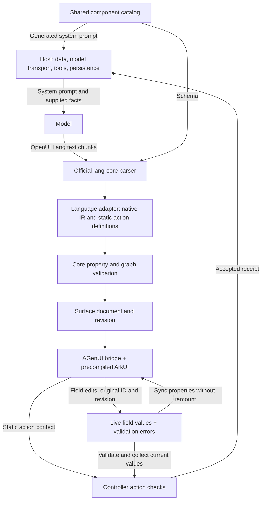

# Architecture

Harmony OpenUI is an independent HarmonyOS adaptation of OpenUI Lang. It reuses the official parser and supplies a bounded native catalog, controller, and renderer. The model produces declarations; the device runs precompiled ArkUI components. The library does not compile or execute generated ArkTS, embed the web renderer, or implement a phone-agent loop.



## Layer ownership

| Layer | Files / dependency | Responsibility |
| --- | --- | --- |
| Official language | `@openuidev/lang-core@1.0.1` | Streaming syntax, component references, action evaluation. |
| Catalog | [`tools/lang/library.mjs`](../tools/lang/library.mjs) | Model-facing signatures and generated schema/system prompt. |
| Language adapter | [`tools/lang/runtime-entry.mjs`](../tools/lang/runtime-entry.mjs), `OpenUiLanguage.ets` | Convert supported syntax into native IR; buffer incomplete native props and retain the last valid tree. |
| Core | `openui/src/main/ets/core/` | Authoritative property/graph checks, document revisions, field state, snapshots and action validation. |
| Native renderer | `openui/src/main/ets/render/`, `@agenui/agenui@1.6.0` | Mount isolation, actual ArkUI controls, measurement, themes and event projection. |
| Host | Your app; the standalone demo is one example | Model HTTP/SSE transport, trusted facts, resource URLs, business rules, tools, history and persistence. |

The official parser is not a substitute for core validation. The native catalog validates limits, types, calendar dates, field uniqueness, form ancestry, and static action context before state is committed. Unsupported syntax is not converted into invented success. The legacy profile exposes 23 model components. v0.3 adds a separate bounded upstream-signature mapping profile; both share core validation and native rendering. See [mapping.md](mapping.md) for the official reactive runtime, generated registry and exact subset.

## A surface has two kinds of state

The **document** contains component definitions, data bindings, selection/read-only decisions, and a revision. A structural change creates a new revision. Complete program replacement remounts; compatible mapped-state patches retain the native manager and surviving nodes. Retired node identities and old mount callbacks cannot act on the new document. Native IDs are namespaced for each mount and reversed back to source IDs before controller validation.

**Live field state** stores typed scalar values and validation errors separately from declarations. A user edit does not change document revision. The existing native session receives updated field properties without destroying the keyboard focus or rebuilding the whole card. Field identity is reconciled when a document changes; removed or incompatible fields do not inherit unrelated answers.

Snapshots can preserve both kinds of state. The host chooses whether and where to persist them; the SDK has no filesystem, account, cloud synchronization, or retention policy of its own. Older v0.1 snapshots without field maps can be loaded with empty maps. Restored documents receive new render revisions.

## Legacy Submit is a validated receipt

```text
root = Stack([trip])
trip = Form("trip", [name, next])
name = TextInput("traveler", "Traveler", "", "Enter a name", true)
next = Button("Continue", @Submit("trip"))
```

The declaration's action context is only `{form: 'trip'}`. It does not contain a model-authored answer object. On a native tap:

1. The renderer maps the current native source ID back to its logical component ID.
2. The controller checks the surface, revision, reachable source, exact static action, and event ID.
3. For Submit, it verifies the containing form and validates current enabled fields.
4. If valid, it appends `fields` read from controller state to the accepted receipt and calls the host.

Empty required inputs, invalid options/date/time/numbers, read-only or obsolete callbacks, and forged field payloads cannot produce an accepted Submit receipt. Disabled fields are omitted. The host still decides what business operation is permitted and what happens after submission.

An ordinary `@Choose`, `@ToAssistant`, or `@OpenUrl` remains action data. The SDK does not execute business effects. A `Dialog` is an explicit native confirmation-sheet launcher; it does not automatically open, bypass Submit checks, or establish that a purchase happened.

## Mapped forms

The mapped profile adds upstream-signature Input, TextArea, CheckBoxGroup, Buttons and Form compositions. The official store holds text and boolean-record values; checkbox leaves remain scalar native controls. Primary conversation actions validate required fields and return a normalized current formName / formState payload. This differs from the legacy custom Submit action and from upstream React hook storage wrappers; see [mapping.md](mapping.md) for the exact boundary.

The mapped runtime owns validation visibility; the controller displays revision-fenced errors through replaceFieldErrors without changing values or document revision. A native field event can create a new evaluated program revision, but compatible native structure remains mounted. Native parser / teardown work is deferred until an active editor callback returns.

Controller observers and host callbacks can synchronously replace a program or change its document. `apply()` returns the revision committed by that call, captured before observers run. The mapped adapter fences subsequent state notifications and actions to that revision and program generation; a retired field event cannot write into a replacement session.

The independent Planner page receives a selected fictional activity, asks the model for an editor, and passes accepted live fields to another model request for a read-only result. It performs no booking or business side effect.

The demo normalizes enum and boolean outcomes into explicit Chinese label/value facts before requesting result layout. The same fact builder supplies local preview and model-result validation. This keeps business-value interpretation in the host; the model arranges supplied facts rather than translating internal mode codes or guessing from an activity description.

v0.5 maps RadioGroup to the existing string-valued native Radio group and SwitchGroup to the existing boolean-record bridge with native Toggle leaves. Radio descriptions remain visible and participate in basic accessibility labels. SwitchGroup follows upstream's independent-container contract; the demo includes its current record explicitly in the action context and checks it against the official store rather than inserting it into a FormControl.

Display-only result arrays use upstream Each, Filter, Sort and Count. The adapter flattens bounded computed child arrays and validates capabilities and budgets; it does not interpret these functions itself. Each templates cannot contain editable fields or forms because loop identity remains positional. This is not keyed editable-list or virtual-list support.

## Multistep demo

The standalone `Forms.ets` page demonstrates `trip → preferences → result` on one surface. “Model form” requests a real model-generated initial trip form. The host then supplies a fixed preferences form containing additional native controls and a confirmation sheet. The final model request receives the two accepted sets of user values and generates a read-only summary, bounded list, and host-supplied project image. “Reset example” exercises the same host flow using local declarations.

This is host orchestration of single-step submissions, not a model-defined workflow engine. The fixture is explicitly fictional and does not query tickets, reserve seats, or make payments. The demo uses complete HTTP responses and feeds parser chunks afterward; it does not yet implement provider SSE framing. The SDK can receive text chunks from another host's real stream.

## Boundaries

- Both profiles are bounded. The mapped profile reuses official local state and local actions; Query/Mutation, video, navigation, charts and arbitrary drawing remain outside scope. Component signatures must not be mixed across profiles.
- Native field updates and compatible mapped-state structural updates are incremental. Full program replacement and incompatible changes still remount.
- Images use host-supplied HTTPS URLs and platform loading. The host controls resource policy and network permissions. Actual loading needs its own device check.
- A2UI v0.9/v0.9.1 NDJSON is an optional subset adapter sharing the controller and renderer; it does not replace the official OpenUI Lang entry point or claim complete protocol conformance.
- Host tests establish contracts; compilation establishes ArkTS/API compatibility. Actual display, editing, pickers, scrolling, image loading, and confirmation require independent device evidence in [verification.md](verification.md).

See [protocol.md](protocol.md) for signatures and state APIs, and [rendering.md](rendering.md) for native mappings, measurement, and mount isolation.
